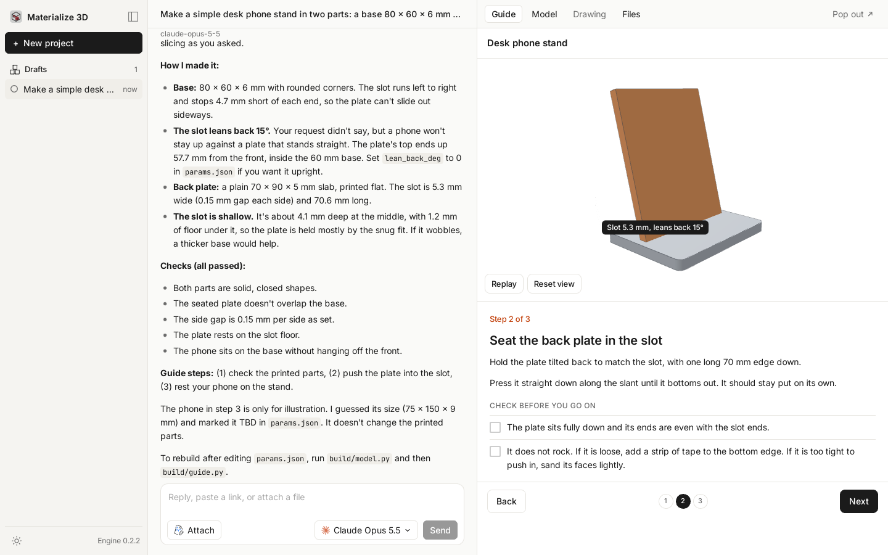

# Materialize 3D

Materialize 3D is a Mac app that makes 3D prints from a chat. You describe an object, and an agent writes the model, previews it, and slices it to a 3MF for a Bambu Lab P2S. You open the 3MF in Bambu Studio and print from there.

**[Download for Mac (Apple Silicon)](https://github.com/AojdevStudio/materialize-3d/releases/latest)** · [Website](https://materialize-3d.pages.dev) · [Install guide](docs/install-macos.md) · [Docs](#docs) · [Issues](https://github.com/AojdevStudio/materialize-3d/issues)

<picture>
  <source media="(prefers-color-scheme: dark)" srcset="docs/images/studio-dark.png">
  
</picture>

The picture and this README show the chat studio in version 0.3.0. That version is not released yet. The latest release is 0.2.2, the earlier sign app.

## How it works

1. **Describe.** Type what you want on the start screen. Add a picture or a link if it helps.
2. **Make.** The agent works in the chat's own project folder, `~/Documents/Materialize 3D/<date>-<slug>/`. It writes and edits files there and runs its build and check scripts with [uv](https://docs.astral.sh/uv/).
3. **Look.** The right panel shows what the agent writes: HTML pages, STL, 3MF, and GLB models in an orbit viewer, and pictures. The Files tab lists every file.
4. **Slice.** The agent slices STL parts with Bambu Studio 02.08.02.61, with the P2S 0.4 mm presets, into a print-ready 3MF.
5. **Print.** Click **Open in Bambu Studio** on the 3MF, check it, and print from Bambu Studio. Materialize 3D does not send jobs to the printer.

A chat keeps its place. A turn that a quit or a crash cut off goes on from its last finished step when the app opens again.

## Requirements

- A Mac with Apple Silicon and macOS 26.0 or later. Intel Macs, Windows, and Linux release builds are not offered.
- A sign-in to one inference provider: Claude, ChatGPT, or OpenCode Go. Claude takes a subscription sign-in or an API key. ChatGPT takes only its own sign-in. OpenCode Go takes only an API key. Your provider's plan or API charges apply. The app is free.
- [uv](https://docs.astral.sh/uv/) and a Python it can run.
- [Bambu Studio 02.08.02.61](https://github.com/bambulab/BambuStudio/releases/tag/v02.08.02.61), installed separately. The app never installs or bundles it.
- To print, a Bambu Lab P2S with a 0.4 mm nozzle.

See [docs/install-macos.md](docs/install-macos.md) for installation, Bambu Studio setup, and uninstalling.

## Docs

- [Install guide](docs/install-macos.md): install, update, set up Bambu Studio, and uninstall.
- [Release notes](docs/releases): what each version changes.
- [Release procedure](docs/releasing.md): how a Mac release is built, signed, and published.
- [Installed GUI checklist](docs/verify-on-mac.md): the acceptance test for an installed release.
- [CI runners](docs/ci-runners.md): the self-hosted runners that CI uses.

## Architecture

The app is a Tauri 2 window over a Bun sidecar. The sidecar runs the agent on Pi Durable and owns every chat in its own store. Rust starts the sidecar, forwards the window's calls to it, keeps sign-ins in the macOS Keychain, runs the Bambu Studio slice step, serves project files to the preview, and installs updates once no agent work is running.

## Build from source

You need [Bun](https://bun.sh) 1.4.4, stable Rust, and on macOS the Xcode command line tools. On Linux, install the [Tauri prerequisites](https://v2.tauri.app/start/prerequisites/). Linux development builds also need a session D-Bus and an unlocked Secret Service, such as GNOME Keyring, to store sign-ins.

```bash
bun install
(cd sidecar && bun install)
scripts/build-sidecar.sh
bun tauri dev
```

Run the checks that CI runs:

```bash
bunx tsc --noEmit
bun run test
(cd sidecar && bunx tsc --noEmit && bun test)
(cd src-tauri && cargo test --lib --locked)
```

The test that slices with a real Bambu Studio is ignored by default. Point `BAMBU_STUDIO_CLI` at a 02.08.02.61 executable and run `cargo test --lib --locked studio::slice -- --ignored`.

A development build is not an installed-release acceptance test. See the [release procedure](docs/releasing.md) and the [installed GUI checklist](docs/verify-on-mac.md).

## Roadmap

These are directions, not commitments or dates:

- more printers and nozzle sizes, each validated before it is offered;
- builds for Intel Macs, Windows, and Linux.

## Contributing

[Issues](https://github.com/AojdevStudio/materialize-3d/issues) and pull requests are welcome. Open an issue before large changes. CI uses the configured [self-hosted runners](docs/ci-runners.md). Jobs that require trusted execution skip fork and Dependabot pull requests.

## License

MIT. See [LICENSE](LICENSE). Bundled fonts keep their own licenses, listed in [THIRD_PARTY_NOTICES.md](THIRD_PARTY_NOTICES.md).

The sidebar icons and the Attach icon are by [Streamline](https://www.streamlinehq.com), licensed under [CC BY 4.0](https://creativecommons.org/licenses/by/4.0/). The Claude and OpenAI marks in the model picker are trademarks of Anthropic and OpenAI, from [Simple Icons](https://simpleicons.org).
